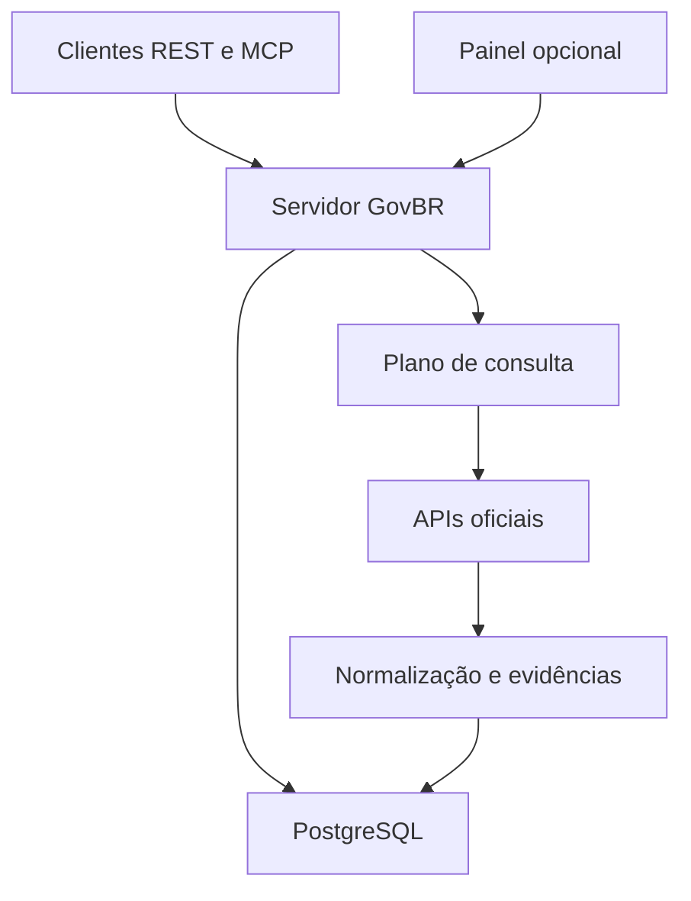

# Arquitetura

FastAPI hospeda REST e MCP Streamable HTTP. O SDK Python MCP também oferece stdio. O painel opcional usa React, TypeScript e Nginx. O Caddy opcional termina TLS. [SDK MCP](https://github.com/modelcontextprotocol/python-sdk).

| Módulo | Responsabilidade |
|---|---|
| `models.py` | Contratos de entrada e saída e validação de filtros |
| `connectors/` | Consultas de leitura e mapeamentos por API oficial |
| `transport.py` | Lista de origens, TLS, prazos, tentativas, limite de bytes e cadência |
| `service.py` | Seleção de fontes, busca concorrente, resolução por identificador e comparação fiscal |
| `storage.py` | Cache, versões, evidências, histórico, acesso e auditoria |
| `mcp_server.py` | Ferramentas e schemas MCP |
| `web.py` | REST, OpenAPI, autenticação, exportação e limpeza periódica |

A instalação padrão executa o servidor e o PostgreSQL. A cadência de acesso a cada portal é controlada dentro de cada processo. Implantações com réplicas devem coordenar esses limites.

PNCP, SICONFI e IBGE oferecem cobertura nacional conforme o conjunto e o exercício. Dados PB cobre recortes do governo estadual. O catálogo informa quais fontes já têm conectores e quais estão planejadas.
